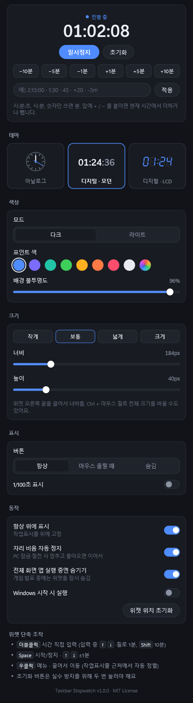
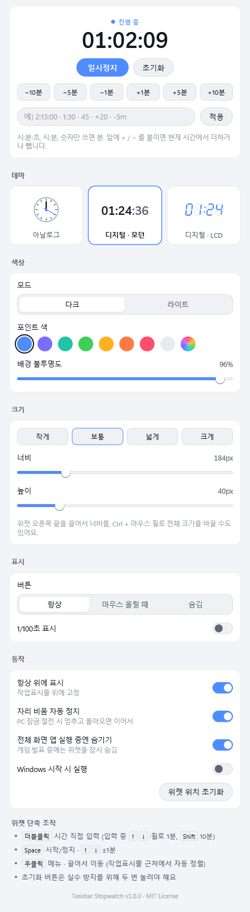

<p align="center">
  
</p>

<h1 align="center">Taskbar Stopwatch</h1>

<p align="center">
  Windows 작업표시줄 위에 작게 붙여 두고 <b>실제 작업 시간</b>을 재는 스톱워치 위젯<br>
  <sub>A tiny stopwatch widget that lives on the Windows taskbar — single 400 KB exe, ~5 MB RAM.</sub>
</p>

<p align="center">
  <a href="https://github.com/everyhalfapp/taskbar-stopwatch/releases/latest">⬇ 최신 버전 다운로드</a>
</p>

---

## 특징

- **가볍습니다** — 실행 파일 하나(약 400KB), 메모리 약 5MB. 웹 엔진 없이 Win32 + Direct2D 로 직접 그립니다.
- **작업표시줄에 딱 붙는 위젯** — 끌어다 놓으면 작업표시줄 높이에 맞춰 자동 정렬, 항상 위에 표시.
- **테마 3종** — 아날로그 · 디지털(모던) · 디지털(LCD), 다크/라이트, 포인트 색, 배경 불투명도.
- **시간 직접 수정** — 깜빡하고 늦게 눌렀어도 `+15`, `1:30:00` 처럼 입력해서 바로잡기.
- **크기 자유롭게** — 오른쪽 끝을 끌어 너비 조절, `Ctrl` + 휠로 전체 크기 조절.
- **작업 시간에 맞춘 동작**
  - PC 잠금·절전 시 자동 정지, 돌아오면 이어서
  - 앱을 끄면 일시정지 상태로 저장 (꺼져 있던 시간은 세지 않음)
  - 게임·발표 같은 전체 화면 앱이 실행 중이면 자동으로 숨김
  - 위젯을 클릭해도 작업 중인 창의 포커스를 빼앗지 않음

| 디지털 | 아날로그 | LCD | 라이트 |
| :-: | :-: | :-: | :-: |
|  |  |  |  |

<details>
<summary><b>설정 창 보기</b></summary>
<p align="center">
   &nbsp; 
</p>
</details>

## 설치

1. [Releases](https://github.com/everyhalfapp/taskbar-stopwatch/releases/latest) 에서 `TaskbarStopwatch-vX.Y.Z-windows-x64.zip` 을 받습니다.
2. 압축을 풀고 `TaskbarStopwatch.exe` 를 원하는 폴더에 두고 실행합니다. 설치 과정은 없습니다.
3. 처음 실행하면 작업표시줄 오른쪽(알림 영역 왼편)에 나타납니다.

> **"Windows의 PC 보호" 창이 뜨는 경우**
> 코드 서명이 없는 개인 프로젝트라 SmartScreen 경고가 나올 수 있습니다. **추가 정보 → 실행** 을 누르면 됩니다.
> 걱정되면 아래 [직접 빌드하기](#직접-빌드하기)로 소스에서 만들어 쓸 수 있습니다.

요구 사항: Windows 10 / 11 (x64)

## 사용법

| 동작 | 방법 |
| --- | --- |
| 시작 / 일시정지 | ▶ 버튼 |
| 초기화 | ↻ 버튼을 **두 번** 클릭 (실수 방지) |
| 시간 직접 입력 | 시간 부분 **더블클릭** → 입력 → `Enter` (`Esc` 취소) |
| 입력 중 조정 | `↑` `↓` 또는 휠로 1분, `Shift` 와 함께 10분 |
| 이동 | 끌어서 이동 — 작업표시줄 근처에 놓으면 자동 정렬 |
| 너비 조절 | 위젯 오른쪽 끝을 끌기 |
| 전체 크기 | `Ctrl` + 마우스 휠 (`Shift` + 휠은 너비만) |
| 메뉴 · 설정 | **우클릭** → 설정… (트레이 아이콘 우클릭도 같음) |
| 숨기기 / 보이기 | 트레이 아이콘 클릭 |

### 시간 입력 형식

| 입력 | 의미 |
| --- | --- |
| `1:30:00` | 1시간 30분 0초로 설정 |
| `1:30` | 1시간 30분 (시:분) |
| `45` | 45분 (숫자만 쓰면 분) |
| `90m` · `1h20m` · `1.5h` · `30s` | 단위 표기 |
| `+10` · `-5m` · `+1:00` | 지금 시간에서 더하기 / 빼기 |

## 설정

우클릭 메뉴의 **설정…** 에서 바꿀 수 있습니다 (우클릭 메뉴에도 대부분 있습니다).

- 테마 · 다크/라이트 · 포인트 색 · 배경 불투명도
- 크기 프리셋 · 너비 · 높이
- 버튼 표시 (항상 / 마우스 올릴 때 / 숨김) · 1/100초 표시
- 항상 위에 표시 · 자리 비움 자동 정지 · 전체 화면 앱 실행 중 숨기기 · Windows 시작 시 실행

설정과 측정 시간은 `%APPDATA%\TaskbarStopwatch\` 에 저장됩니다.

## 제거

1. 설정에서 **Windows 시작 시 실행** 을 끕니다 (켜 두었다면).
2. 우클릭 → **종료** 후 `TaskbarStopwatch.exe` 를 지웁니다.
3. 저장된 설정까지 지우려면 `%APPDATA%\TaskbarStopwatch` 폴더를 지웁니다.

## 직접 빌드하기

필요한 것: [Rust](https://rustup.rs) (MSVC 툴체인), Visual Studio Build Tools (C++ 데스크톱 개발)

```powershell
git clone https://github.com/everyhalfapp/taskbar-stopwatch.git
cd taskbar-stopwatch
cargo build --release
# → target\release\TaskbarStopwatch.exe
```

Rust 버전은 `rust-toolchain.toml` 로 고정되어 있어 자동으로 맞춰집니다.

배포용 zip 만들기:

```powershell
powershell -ExecutionPolicy Bypass -File scripts\package.ps1
# → dist\TaskbarStopwatch-v1.0.0-windows-x64.zip
```

### 개발용 옵션

| 옵션 | 설명 |
| --- | --- |
| `--snapshot-widget out.png <analog\|digital\|lcd> <dark\|light> [배율] [색 hex] [cs]` | 위젯 화면을 PNG 로 저장 |
| `--snapshot-settings out.png [dark\|light] [너비]` | 설정 창 화면을 PNG 로 저장 |
| 환경 변수 `SW_DATA_DIR` | 설정·시간 저장 폴더를 바꿈 (테스트용) |

### 구조

| 파일 | 내용 |
| --- | --- |
| `src/main.rs` | 창 · 입력 · 메뉴 · 트레이 · 절전/잠금 처리 |
| `src/gfx.rs` | 위젯 그리기 (Direct2D 소프트웨어 렌더링 → 레이어드 창) |
| `src/settings_ui.rs` | 설정 창 |
| `src/model.rs` | 설정 · 타이머 상태와 저장 |
| `src/timefmt.rs` | 시간 표시 · 입력 해석 (`cargo test`) |
| `src/tray.rs` | 알림 영역 아이콘 |
| `assets/` | 앱 아이콘 · 매니페스트 · 버전 정보 (`scripts/make_icon.py` 로 아이콘 생성) |

## 라이선스

[MIT](LICENSE)
